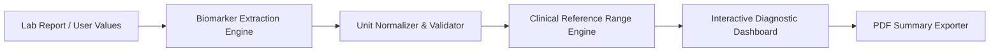

# Lab Clarity — Medical Diagnostic Biomarker & Lab Report Intelligence Platform

> Intelligent medical lab report parsing, biomarker range evaluation, reference interval contextualization, and secure PDF export built with React 18, Vite, and containerized deployment.

---

## 1. Project Title
**Lab Clarity** (`Lab-Clarity-Final`) — Automated Clinical Laboratory Report & Biomarker Intelligence System.

## 2. Project Overview
Lab Clarity is a specialized diagnostic analysis web application created to help patients and clinicians interpret complex blood panels and laboratory tests. By extracting clinical biomarkers, comparing values against established reference ranges, and categorizing metrics into physiological categories (Lipid, Metabolic, Complete Blood Count, Renal), it renders medical data intuitive and understandable.

## 3. Key Features
- **Extracted Biomarker Analysis (`ExtractedValuesDisplay.tsx`):** Automated classification of test parameters against age- and gender-adjusted standard ranges.
- **Visual Range Indicators:** Real-time color-coded indicators for Normal, Borderline, and Critical metrics.
- **Direct PDF Clinical Export (`PDFExport.tsx`):** Download cleanly formatted diagnostic summaries for physician reviews.
- **Full Dockerized Infrastructure:** Production-grade `Dockerfile` and multi-stage container optimization.

## 4. Technology Stack
- **Frontend:** React 18, Vite, TypeScript, Tailwind CSS, Lucide React, shadcn/ui
- **Containerization & CI:** Docker, Multi-stage builds, GitHub Actions

## 5. System Architecture


## 6. Installation & Docker Run
```bash
# Local Development
npm install
npm run dev

# Docker Deployment
docker build -t lab-clarity .
docker run -p 80:80 lab-clarity
```

## 7. Author & Project Information
- **Lead Developer:** Chethan Kumar B S (`StratagemVX`)
- **Institution:** MVJ College of Engineering
- **Focus:** HealthTech & Diagnostic Data Engineering
