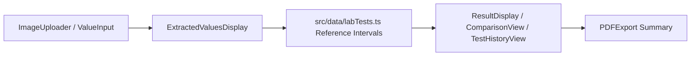

# Lab Clarity (`Lab-Clarity-Final`) — Clinical Lab Report & Biomarker Intelligence UI

> Interactive web application for inspecting common medical lab parameters against reference intervals, organizing panels by clinical category, comparing results, and exporting PDF summaries, built with React 18, TypeScript, Vite, Tailwind CSS, and Docker.

[](https://react.dev/)
[](https://www.typescriptlang.org/)
[](https://www.docker.com/)
[](https://tailwindcss.com/)

---

## Executive Overview

**Lab Clarity** (`Lab-Clarity-Final`) helps users organize and review clinical biomarker results against structured reference datasets (`src/data/labTests.ts`). Users can browse test categories (`CategorySelector`), upload or inspect report values (`ImageUploader`, `ValueInput`, `ExtractedValuesDisplay`), compare trends (`ComparisonView`), track local history (`TestHistoryView`, `useTestHistory`), view educational explanations (`ResultDisplay`), and generate PDF reports (`PDFExport`) alongside an educational medical disclaimer (`DisclaimerBanner`).

> **Quality & CI Status (`main` vs. Open Draft PR #2 — `maintenance/repository-quality-improvements`):**
> - **PR #2** upgrades vulnerable npm dependencies in `package-lock.json`, resolves lint/TypeScript issues across components (`ExtractedValuesDisplay.tsx`, `PDFExport.tsx`, `useTestHistory.tsx`, `tailwind.config.ts`), fixes `Dockerfile` & `.gitignore`, adds `typecheck` & `test` scripts with `vitest` tests (`src/data/labTests.test.ts`), and adds `.github/workflows/quality.yml` (verified passing in CI).

---

## System Flow & Directory Structure



```text
Lab-Clarity-Final/
├── .github/workflows/quality.yml    # CI: npm ci, audit, typecheck, lint, test, build (PR #2)
├── src/
│   ├── components/
│   │   ├── CategorySelector.tsx
│   │   ├── ComparisonView.tsx
│   │   ├── DisclaimerBanner.tsx
│   │   ├── ExtractedValuesDisplay.tsx
│   │   ├── Header.tsx
│   │   ├── ImageUploader.tsx
│   │   ├── PDFExport.tsx
│   │   ├── ResultDisplay.tsx
│   │   ├── TestHistoryView.tsx
│   │   ├── TestSelector.tsx
│   │   ├── ThemeToggle.tsx
│   │   ├── ValueInput.tsx
│   │   └── ui/
│   ├── data/
│   │   ├── labTests.ts              # Biomarker catalog and reference ranges
│   │   └── labTests.test.ts         # Vitest biomarker dataset & evaluation tests (PR #2)
│   ├── hooks/                       # useTestHistory.tsx, useTheme.tsx, use-mobile.tsx, use-toast.ts
│   ├── pages/                       # Index.tsx, NotFound.tsx
│   └── App.tsx
├── Dockerfile
├── package.json
└── README.md
```

---

## Setup, Docker & Verification Scripts (`package.json`)

```bash
git clone https://github.com/StratagemVX/Lab-Clarity-Final.git
cd Lab-Clarity-Final

npm ci --ignore-scripts
npm run dev
```

### Container Execution
```bash
docker build -t lab-clarity .
docker run -p 80:80 lab-clarity
```

### Available Package Scripts
| Script | Command | Notes |
|---|---|---|
| `npm run dev` | `vite` | Start Vite dev server |
| `npm run build` | `vite build` | Production build |
| `npm run typecheck` | `tsc --noEmit` | Added in PR #2 |
| `npm run lint` | `eslint .` | ESLint checks |
| `npm test` | `vitest run` | Added in PR #2 (`src/data/labTests.test.ts`) |
| `npm run preview` | `vite preview` | Preview built output |

*Educational tool only; not a certified clinical diagnostic device.*

---

## Contributor Attribution & Profile

- **Lead Engineer:** Chethan Kumar B S (`StratagemVX`)
- **Related Bench Prototype:** [StratagemVX/lab-clarity](https://github.com/StratagemVX/lab-clarity)
- **GitHub:** [https://github.com/StratagemVX](https://github.com/StratagemVX)
- **Portfolio:** [https://chethan-kumar-portfolio.vercel.app/](https://chethan-kumar-portfolio.vercel.app/)
- **LinkedIn:** [https://linkedin.com/in/chethan-kumar-b-s-781a002bb](https://linkedin.com/in/chethan-kumar-b-s-781a002bb)
