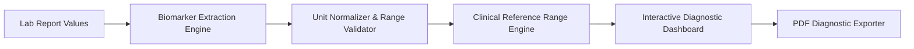

# Lab Clarity — Medical Diagnostic Biomarker & Lab Report Intelligence Platform

> An automated clinical laboratory report intelligence platform evaluating extracted physiological biomarkers against standard reference intervals with Docker containerization and PDF clinical export.

[](https://react.dev/)
[](https://www.typescriptlang.org/)
[](https://www.docker.com/)
[](https://tailwindcss.com/)

---

## Executive Overview

Lab Clarity (`Lab-Clarity-Final`) is a clinical laboratory diagnostic intelligence platform developed to translate complex blood work and pathology lab values into actionable, visual health metrics. By parsing physiological parameters, contextualizing extracted numbers against demographic reference intervals, and rendering categorized biomarker dashboards (Complete Blood Count, Lipid Panels, Metabolic Profiles, Renal Metrics), Lab Clarity empowers patients and clinicians to detect anomalies rapidly.

---

## Core Capabilities & Features

### Implemented Features
- **Automated Biomarker Range Evaluation (`ExtractedValuesDisplay.tsx`):** Compares patient lab values against standard clinical reference intervals, color-coding Low, Normal, Borderline, and Critical metrics.
- **Categorized Physiological Panels (`CategorySelector.tsx`):** Automatically organizes tests into clinical categories: Hematology, Lipid Profile, Renal Function, Liver Panel, and Metabolic Markers.
- **Clinical Summary PDF Export (`PDFExport.tsx`):** Generates clean, formatted diagnostic summary reports for physician consultations.
- **Historical Comparison View (`ComparisonView.tsx`):** Visual progression tracking comparing previous lab values over time.
- **Containerized Deployment Infrastructure:** Production `Dockerfile` and `.dockerignore` optimized for multi-stage container deployments.

---

## System Architecture



---

## Directory Structure

```text
Lab-Clarity-Final/
├── src/
│   ├── components/
│   │   ├── CategorySelector.tsx     # Diagnostic panel selector
│   │   ├── ComparisonView.tsx       # Historical biomarker comparison
│   │   ├── DisclaimerBanner.tsx     # Clinical notice banner
│   │   ├── ExtractedValuesDisplay.tsx # Biomarker indicator cards
│   │   ├── ImageUploader.tsx        # Report image / document uploader
│   │   ├── PDFExport.tsx            # Formatted PDF export generator
│   │   └── ResultDisplay.tsx        # Diagnostic visual results shell
│   ├── App.tsx                      # Main application view container
│   └── main.tsx                     # React DOM mount point
├── Dockerfile                       # Multi-stage production container build
├── .dockerignore                    # Build optimization directives
├── package.json                     # Dependencies and scripts
└── README.md                        # Master repository technical documentation
```

---

## Setup & Execution

### Local Development
```bash
npm install
npm run dev
```

### Docker Production Deployment
```bash
docker build -t lab-clarity .
docker run -p 80:80 lab-clarity
```

---

## Contributor Attribution & Profile

- **Lead Engineer:** Chethan Kumar B S (`StratagemVX`)
- **Institution:** Department of Computer Science & Engineering, MVJ College of Engineering
- **GitHub:** [https://github.com/StratagemVX](https://github.com/StratagemVX)
- **Portfolio:** [https://chethan-kumar-portfolio.vercel.app/](https://chethan-kumar-portfolio.vercel.app/)
- **LinkedIn:** [https://linkedin.com/in/chethan-kumar-b-s-781a002bb](https://linkedin.com/in/chethan-kumar-b-s-781a002bb)
